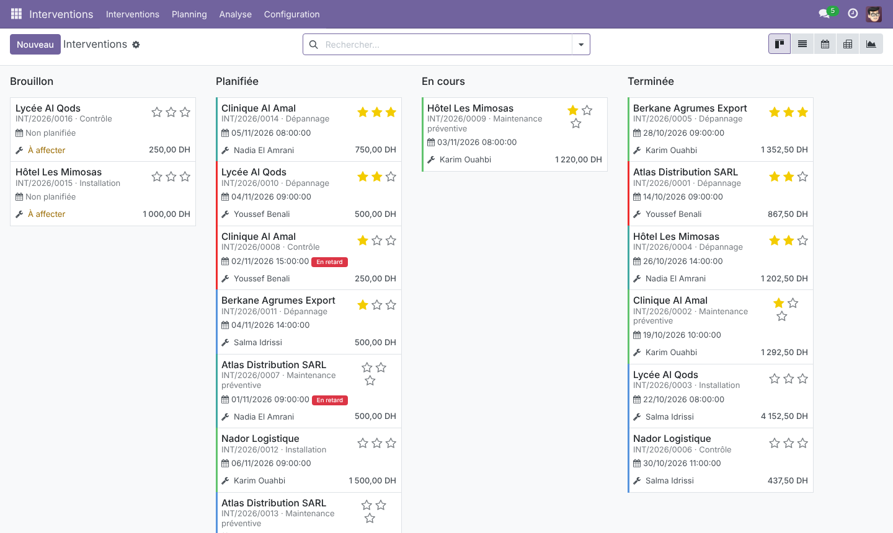
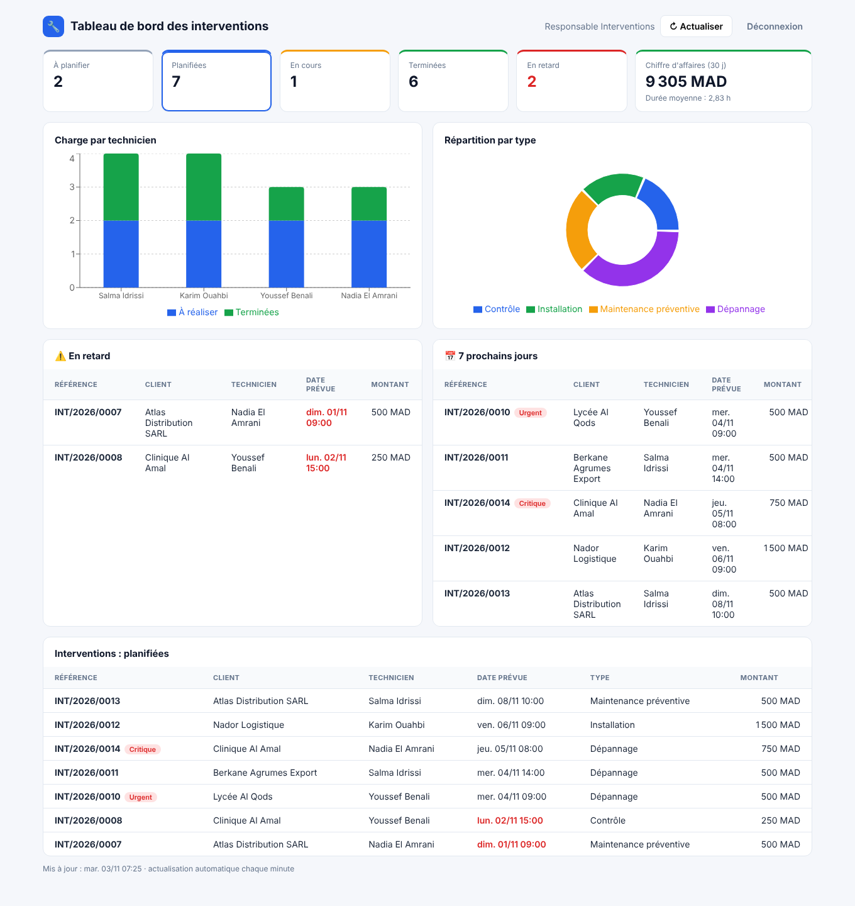
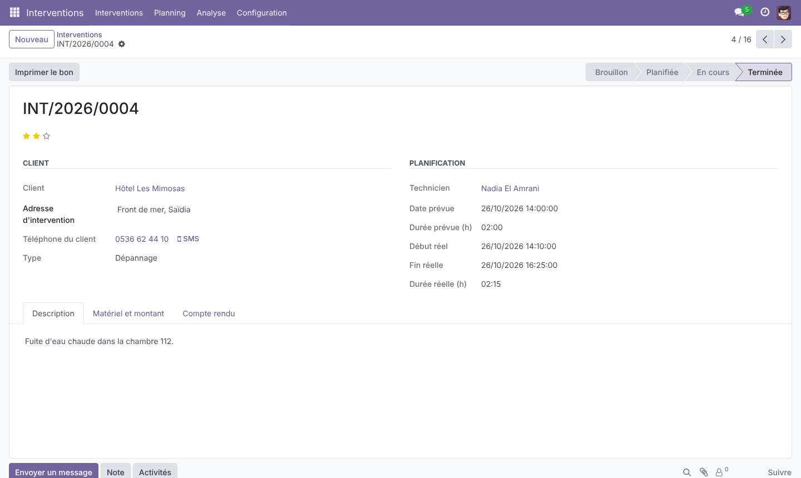
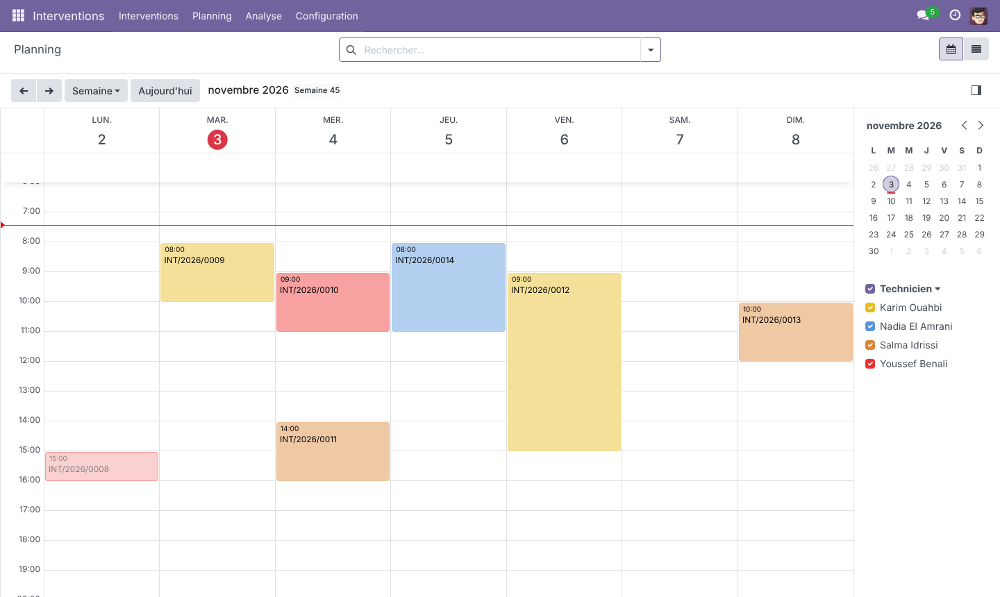

# 🔧 Gestion des interventions – Module Odoo 17 + tableau de bord React

> Module Odoo pour une entreprise de services techniques (maintenance, dépannage, installation) : **planification des interventions chez les clients**, suivi des techniciens, matériel utilisé, **bon d'intervention PDF**, et **API JSON** consommée par un **tableau de bord React** de pilotage.




## ✨ Fonctionnalités

**Dans Odoo**
- **Interventions** : client, adresse (reprise de la fiche client), type, priorité, technicien, date et durée prévues, description, compte rendu.
- **Workflow** : `Brouillon → Planifiée → En cours → Terminée`, avec annulation et remise en brouillon. Chaque étape est contrôlée (on ne termine pas une intervention qui n'a pas démarré, on ne supprime pas une intervention planifiée…).
- **Anti-chevauchement** : un technicien ne peut pas avoir deux interventions planifiées sur le même créneau.
- **Matériel et montant** : lignes de matériel, main-d'œuvre (taux horaire × durée réelle une fois terminée, sinon durée prévue), total.
- **Interventions en retard** : champ calculé et filtrable (planifiée mais date dépassée), ruban rouge sur la fiche.
- **Vues** : kanban par état, liste, formulaire avec barre d'état, **calendrier** (planning par technicien), **pivot** et **graphique**.
- **Bon d'intervention PDF** (rapport QWeb) avec matériel, total et zones de signature.
- **Sécurité** : groupe *Technicien* (ne voit que ses propres interventions, via une règle d'enregistrement) et groupe *Responsable* (voit tout, planifie, configure). Règle multi-société.
- **Historique** : suivi des modifications (chatter `mail.thread`) et activités.
- Bouton « Interventions » sur la fiche client, compteurs sur la fiche technicien.

**Tableau de bord React**
- Connexion avec un compte Odoo (session Odoo, aucune donnée en dur).
- Indicateurs : à planifier, planifiées, en cours, terminées, en retard, chiffre d'affaires sur 30 jours, durée moyenne.
- Graphiques : charge par technicien, répartition par type.
- Listes : interventions en retard, 7 prochains jours, liste filtrable par état.
- Rafraîchissement automatique chaque minute.



## 🖼️ Captures

| Formulaire | Planning |
|---|---|
|  |  |

## 🏗️ Architecture

```
addons/intervention_management/
├── models/
│   ├── intervention.py              # modèle principal, workflow, contraintes, calculs
│   ├── intervention_line.py         # matériel utilisé
│   ├── intervention_technician.py   # techniciens
│   └── res_partner.py               # héritage de la fiche client
├── views/                           # vues XML : kanban, liste, formulaire, calendrier, pivot, graphique, recherche, menus
├── security/                        # groupes, droits d'accès (CSV), règles d'enregistrement
├── report/                          # bon d'intervention QWeb (PDF)
├── controllers/api.py               # API JSON : /api/interventions et /api/interventions/stats
├── data/                            # séquence INT/2026/0001, données de démonstration
└── tests/                           # 16 tests (TransactionCase + HttpCase)
dashboard/                           # application React (Vite, Recharts)
```

```
Navigateur ──► Nginx (tableau de bord React, port 8080)
                 ├── /             → application React compilée
                 └── /web/session, /api  → Odoo 17 (port 8069) ──► PostgreSQL 16
```

**Choix techniques**
- **Statut « en retard » calculé, avec méthode de recherche** (`_search_is_late`) : pas de tâche planifiée pour le mettre à jour, et il reste filtrable dans les vues.
- **Compteurs par `_read_group`** : une seule requête SQL groupée pour tous les techniciens affichés, au lieu d'une requête par ligne.
- **Le kanban affiche toutes les colonnes d'état**, même vides (`group_expand`), pour visualiser tout le flux.
- **API protégée par la session Odoo** (`auth="user"`) : les droits et règles d'accès s'appliquent aussi à l'API, donc un technicien ne voit que ses interventions dans le tableau de bord.
- **Même origine** : Nginx (ou le proxy Vite en développement) sert le tableau de bord et relaie `/web/session` et `/api` vers Odoo. Le cookie de session fonctionne sans configuration CORS.
- **Données de démonstration aux dates relatives** à la date d'installation, pour que le planning et le tableau de bord soient toujours réalistes.

## 🚀 Lancer le projet

```bash
git clone https://github.com/mohammed-mrabet/odoo-interventions.git
cd odoo-interventions
docker compose up --build
```

- **Odoo** : http://localhost:8069 – identifiant `admin`, mot de passe `admin`, puis menu **Interventions**.
- **Tableau de bord** : http://localhost:8080 – mêmes identifiants.

Le premier démarrage crée la base `interventions`, installe le module avec des données de démonstration (6 clients, 4 techniciens, 17 interventions) et charge le français. Pour afficher Odoo en français : avatar → *Préférences* → *Langue : Français*.

### Développement du tableau de bord

```bash
cd dashboard
npm install
npm run dev        # http://localhost:5173, /web et /api redirigés vers Odoo (localhost:8069)
```

## 🧪 Tests

```bash
docker compose run --rm odoo odoo -d test_interventions -i intervention_management \
  --test-enable --test-tags=/intervention_management --stop-after-init
```

16 tests couvrent : la séquence et l'adresse, le workflow complet, les transitions interdites, le chevauchement de planning (et les cas autorisés), le calcul des montants, le retard et sa recherche, la suppression, les compteurs, **les droits d'un technicien** (il ne voit que ses interventions et ne peut pas en créer), le rendu du rapport QWeb et l'API JSON (authentification obligatoire, filtres, validation des paramètres, statistiques).

La CI GitHub Actions installe le module dans un vrai Odoo 17 avec PostgreSQL, lance ces tests et compile le tableau de bord React.

## 📡 API

| Route | Description |
|---|---|
| `GET /api/interventions?state=planned&technician_id=2&limit=50&offset=0` | Liste paginée et filtrée |
| `GET /api/interventions/stats` | Indicateurs du tableau de bord |

Authentification : session Odoo (`POST /web/session/authenticate`).

## 🗺️ Pistes d'amélioration

- Signature du client sur tablette (widget `signature`) et photos avant/après
- Génération de la facture depuis l'intervention (module Comptabilité)
- Notification au client par e-mail ou SMS lors de la planification
- Application mobile pour les techniciens

## 👤 Auteur

**Mohammed MRABET** – Master Ingénierie Informatique, Faculté des Sciences d'Oujda
[LinkedIn](https://www.linkedin.com/in/mohammed-mrabet-b3021b410/) · [GitHub](https://github.com/mohammed-mrabet)
